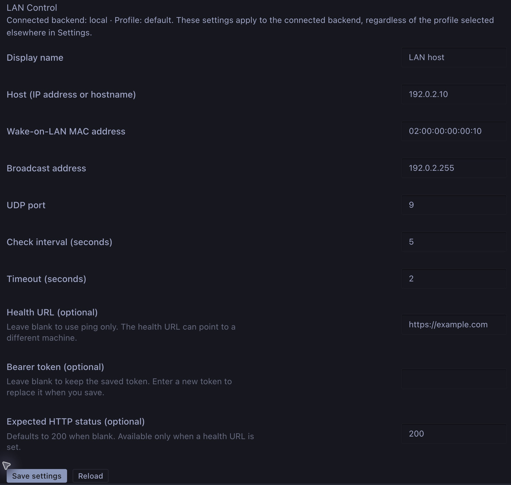

# Hermes LAN Control

[](https://github.com/andrepester/hermes-lan-control/actions/workflows/ci.yml)
[](https://github.com/andrepester/hermes-lan-control/actions/workflows/security.yml)
[](https://github.com/andrepester/hermes-lan-control/actions/workflows/codeql.yml)

Check a host's reachability and wake it from the Hermes Desktop status bar.
Hermes LAN Control combines an independent **ping check**, an optional **HTTP
health check**, and a manual **Wake-on-LAN** button in a compact display:

**Status dot · Display name · Power icon**

## Why this plugin?

Hermes often runs alongside other machines on the local network—for example, a
workstation providing local AI inference or a server hosting a service. Those
machines may only be needed occasionally, so keeping them running around the
clock is unnecessary.

Hermes LAN Control brings that workflow into Hermes Desktop: see whether a host
responds, optionally check whether an HTTP service is available, and wake the
host when needed. There is no need to open a terminal or a separate Wake-on-LAN
app. Independent host and service checks help distinguish network reachability
from service availability, including setups where the service endpoint lives on
another machine.


LAN Control in the bottom-right status bar, alongside Hermes' native indicators.

| Checks passed | Ping and HTTP disagree | Checks failed |
| --- | --- | --- |
|  |  |  |

Native Hermes Desktop screenshots with a neutral display name and theme colors.
Green: ping responds, HTTP disabled. Yellow: ping responds, HTTP fails.
Red: neither check passes. Power availability follows ping, as explained below.

Click the name or status dot to check again. Click the power icon to send a
Wake-on-LAN magic packet when the target does not respond to ping.

The plugin adds no chat tools, model calls, telemetry, automatic wake actions,
or shutdown function. Its interface is in English, regardless of the app language.

## Install from Git

In Hermes Desktop, open **Capabilities → Plugins → Install from Git** and paste:

```text
https://github.com/andrepester/hermes-lan-control
```

Select both **Agent** (on the intended backend/profile) and **Desktop** (on this
computer), review the source, and confirm installation. Activate **LAN Control**,
then open its settings to enter the host and, for Wake-on-LAN, the MAC and
broadcast addresses. If the backend routes are unavailable, restart its gateway;
if the status-bar item is missing, run **Reload desktop plugins**.

This uses Hermes' [native Git installation dialog](https://hermes-agent.nousresearch.com/docs/user-guide/features/plugins#one-click-install-links-desktop)
for both components, including with a remote backend. No manual file copying or
app rebuild is needed. Git installation does not require a GitHub release.
To install a specific reviewed revision, enter its full 40-character SHA in
**Pin to commit**. Without a pin, installation uses the repository's default
branch. The supported Hermes minimum is **v0.22.3** for both the backend and
Desktop.

## Requirements

- Hermes Desktop **v0.22.3 or newer**, with the public desktop plugin SDK and unified plugin package
  support. A CLI-only installation cannot display the status-bar controls.
- A running Hermes backend **v0.22.3 or newer** that can reach the target network. **Ping, HTTP,
  and Wake-on-LAN run on the backend machine**, which may differ from the
  computer running Desktop. A sleeping machine cannot act as its own sender.
- The native `ping` executable on the backend; macOS also needs `ping6` for IPv6.
  Hermes supplies the Python libraries used by the plugin. The plugin does not
  require additional raw-socket packages or request elevated privileges; the
  system's ping permissions must allow the Hermes user to run it.
- For Wake-on-LAN: compatible target firmware, network adapter, and operating
  system settings, plus the target MAC address and a suitable IPv4 broadcast
  address. Broadcasts do not automatically cross routers or VPNs.

The supported minimum is **v0.22.3**, verified with release-specific Desktop
builds and native smoke tests on macOS for v0.22.3, v0.22.4 and v0.22.5.
The smoke test covers plugin discovery,
activation, loopback ping and authenticated HTTP, manual rechecking, and saving
settings and a synthetic token. Older releases have no compatibility guarantee.
Linux and Windows ping handling is covered by process mocks only. The status-bar
colors have also been checked in native Hermes Desktop on macOS.
Offline integration tests cover Git installation, activation, update, removal,
and Hermes' real desktop file reconciliation against a pinned source revision.
The maintainer confirmed native functional acceptance in their local installation
on 2026-10-31. Automated tests do not send real Wake-on-LAN packets. See the
[runbook](RUNBOOK.md) for test coverage and its limits.

## Installation from a source checkout

These instructions assume an existing source checkout. On the backend, place
the native plugin package in the intended profile's plugin directory:
`$HERMES_HOME/plugins/lan-control/` (`~/.hermes/plugins/lan-control/` for the
default home).

```text
lan-control/
├── plugin.yaml
├── __init__.py
├── dashboard/
│   ├── manifest.json
│   └── plugin_api.py
├── desktop/
│   └── plugin.js
├── README.md
└── LICENSE
```

Keep the directory name and plugin ID **`lan-control`**. Test dependencies,
virtual environments, build output, and caches are not needed for installation.

1. In Hermes Desktop's plugin manager, rescan plugins and find **LAN Control**.
2. Activate the plugin. It needs both its **Agent** backend and **Desktop** UI;
   the overall **Activate/Deactivate** control manages both together. The
   additional component switches are provided by Hermes. The desktop component
   ships disabled by default.
3. Restart the backend gateway if its new routes have not been loaded. If the UI
   is missing after a rescan, run **Reload desktop plugins** from the command
   palette.
4. Open **Settings → Plugins → LAN Control** and configure the host.

Activating a configured plugin starts real ping and optional HTTP checks.
Wake-on-LAN requires an explicit click on the power icon.

For a local backend, Hermes manages the desktop copy from `desktop/plugin.js`;
no app rebuild is needed. For a remote backend, the UI component must also be
installed on the computer running Desktop. Copying files only to the remote
backend does not install a local UI. See Hermes' [unified package and remote
backend documentation](https://hermes-agent.nousresearch.com/docs/developer-guide/desktop-plugin-sdk#one-package-both-sdks).

## Configuration



Native settings page with example values. Replace them with your own network
settings; the bearer token field is left blank.

The settings page displays the **connected backend and active profile** it will
edit. The separate profile selector elsewhere in Settings does not change this
page's target. Switch the active connection/profile before editing another
backend. Switching discards unsaved drafts.

For ping-only monitoring, enter the host and leave the health URL blank. To
enable Wake-on-LAN, also enter the target MAC and broadcast addresses.

| Setting | Default and behavior |
| --- | --- |
| Display name | Optional, up to 200 characters. Blank uses the ping host. |
| Host (IP address or hostname) | Required when saving. Identifies the ping and Wake-on-LAN target; enter an address or hostname, not a URL. |
| Wake-on-LAN MAC address | Blank disables wake actions. Accepts 12 hex digits or six pairs with consistent `:` or `-` separators. Zero and multicast MACs are rejected. |
| Broadcast address | Required for wake actions. Enter the IPv4 broadcast address for the target network; it is not detected automatically. Loopback, multicast, and unspecified addresses are rejected. |
| UDP port | `9`; whole number from 1 to 65535. |
| Check interval (seconds) | `60`; range 2–300. Explicitly saved values are kept. |
| Timeout (seconds) | `2`; range 0.2–30, strictly shorter than the check interval. Applies to each parallel check. |
| Health URL (optional) | Blank uses ping only. Accepts HTTP or HTTPS, without embedded credentials or a fragment. |
| Bearer token (optional) | Blank keeps the saved token. Enter a new token to replace it. Use HTTPS when sending a token. |
| Expected HTTP status (optional) | Blank means `200`; otherwise a whole number from 100 to 599. `401` and `403` always count as authentication failures. |

Click **Save settings** once to save normal settings and a newly entered token.
With no health URL, the token and expected-status fields are disabled, existing
values are retained, and neither is used for checks. A new token draft is not
sent while the health URL is blank. A blank token field never clears a saved
secret; use Hermes' native secret management to remove it.

The backend validates the complete draft before saving. A revision check prevents
one plugin settings window from overwriting changes saved by another; a conflict
reloads the current values for review.

Settings and a new token are submitted together. HTTP checks are paused while
the update is written, so changing the endpoint and token cannot send the old
token to the new endpoint or the new token to the old endpoint. The pause is
persisted before rotating the token. If a write fails or the backend stops
mid-update, HTTP may remain disabled; the page reports the partial result and
keeps the draft for a retry in the same profile. Review and save again to finish.
Blank tokens still keep the existing secret, including when changing the URL.
**Reload** reads the current settings and discards unsaved edits.

**The ping host and HTTP endpoint may be different machines.** The plugin does
not derive an IP address from a MAC address. For older configurations without an
explicit host, it initially uses the hostname from the existing health URL. Check
the inferred host and save it; later URL changes will then leave the ping target
unchanged.

## Status and Wake-on-LAN

Hover over the display to see the separate ping and HTTP results. Long display
names are shortened to fit, with the full name available in the tooltip.

| Ping result | HTTP result, if configured | Status dot | Power icon |
| --- | --- | --- | --- |
| Responds | Expected status | Green | Disabled |
| Responds | Failure, timeout, or unexpected status | Yellow | Disabled |
| No response | Expected status | Yellow | Enabled if Wake-on-LAN is configured |
| No response | Failure, timeout, or unexpected status | Red | Enabled if Wake-on-LAN is configured |
| Responds | Not configured | Green | Disabled |
| No response | Not configured | Red | Enabled if Wake-on-LAN is configured |
| Unknown, local ping error, stale result, or backend/configuration error | Any | Red | Disabled |

A successful HTTP check **does not block Wake-on-LAN when ping gets no
response**, because the endpoint may belong to another machine. An unexpected
internal check error blocks sending. Missing or invalid wake settings disable
the power icon while valid status checks continue.

- Clicking the **name or status dot** starts a fresh check, bypassing the
  backend cache. It sends no magic packet. Repeat check clicks and Wake-on-LAN
  are disabled while the manual check is running.
- Clicking the **power icon** makes the backend check again before sending.
  If the host now responds, no packet is sent. Each send attempt is followed by
  a **10-second cooldown**, including attempts that fail to send. A status read
  at cooldown expiry refreshes the button even with a longer check interval;
  it is enabled again only after a valid backend response.
- A send confirmation means the packet was handed to the local network stack.
  It does not prove delivery or change the status dot to green; subsequent checks
  determine the displayed state.
- After a confirmed send, a fresh check starts immediately, then every **five
  seconds** until ping responds or **180 seconds** have elapsed since Desktop
  received the confirmation. Slow requests delay the next start; checks do not
  overlap or catch up on missed starts. These checks bypass the normal cache
  and also check HTTP when configured, using the configured timeout.
  HTTP success alone does not end the wait. Ping success returns to the normal
  configured interval even if HTTP still fails (yellow status).
- The display name stays visible. While waiting, the tooltip and accessible
  description show elapsed time and separate ping/HTTP results. At the deadline,
  the tooltip reports **No ping response within 180 seconds** and any current
  check problem. There is no additional success notification or automatic resend.
  Manual checks do not restart the deadline. A new explicit wake attempt replaces
  the previous wait; only a confirmed send starts a new one.
- The temporary wait exists only in the active Desktop controller. Profile,
  connection, or configuration changes, disconnection, disabling, and reloading
  discard it. Reconnection does not resume it. The saved interval is unchanged.
- Requests have a 32-second backend budget, including waiting for another check;
  the desktop transport allows 35 seconds. A wake action that exceeds its budget
  is blocked before sending. Wake requests also carry a server-issued expiry,
  so time spent buffered in a proxy or plugin host cannot extend their lifetime.
  Direct HTTP requests are additionally checked for client disconnection before
  sending. Long check intervals renew the action expiry through cached status
  reads without triggering extra ping or health probes.

A missing ping response does not prove the target is asleep: ICMP may be
filtered. Configure the network's actual broadcast address; the plugin validates
the address format but cannot infer the correct subnet or guarantee delivery.

## Behavior and permissions

The enabled desktop component requests periodic status checks from the connected
backend and provides a manual recheck. On that backend, the plugin:

- Starts the system `ping` (or macOS `ping6`) executable as a subprocess, using
  an argument list without a shell. DNS lookup and ping share the check timeout.
- Makes HTTP GET requests to the configured health endpoint, if present. This
  can be a local or third-party service and can be on another machine.
- Sends a UDP magic packet to the configured IPv4 broadcast address and port
  only after an explicit wake action and a fresh host check.
- Reads its settings and optional bearer token through Hermes' profile-scoped
  configuration and secret APIs, outside the plugin package directory. Saving
  settings or a token writes through Hermes' configuration/secret handling.

Status results are cached in memory per backend profile. Checks are driven by
desktop requests; the plugin does not start a separate background daemon.

The bearer token is stored through Hermes' profile-scoped secret handling as
`LAN_CONTROL_BEARER_TOKEN`. It is not returned to the UI. Normal settings remain
in Hermes' plugin configuration for the selected backend profile.

HTTP checks use GET, verify TLS certificates, do not follow redirects, ignore
proxy environment variables, and do not read the response body. Use the final
health endpoint URL. Plain HTTP sends bearer tokens unencrypted; use HTTPS for
authenticated endpoints. Keep credentials out of URLs and display names.

## Troubleshooting

- **No status-bar item:** check that the Desktop component is installed locally
  and enabled, then rescan or reload desktop plugins.
- **Cannot reach the plugin backend:** check the active connection/profile,
  enable the Agent component there, and restart its gateway if necessary.
- **Red dot and disabled power icon:** read the tooltip. Check the host, native
  ping executable, DNS, permissions, connection, and wake settings. Local ping
  errors are treated as unknown host state.
- **Yellow dot:** ping and HTTP disagree. Read both results; the dot's color
  alone does not determine whether Wake-on-LAN is available.
- **Packet sent but target stays offline:** check target WoL support, MAC,
  broadcast address, UDP port, and network routing/firewall rules from the
  backend machine.

## Development and verification

The plugin uses Hermes' public plugin APIs and desktop SDK. It requires no core
patches. Automated tests mock ping processes and UDP sends; HTTP integration
tests use loopback. The browser harness renders the actual React component in a
simulated Hermes shell and is not a native desktop acceptance test.

See [RUNBOOK.md](RUNBOOK.md) for isolated test setup,
browser checks, and native verification procedures. Keep test
dependencies separate from the production Hermes environment.

For security reporting and the scope of automated scans, see
[SECURITY.md](SECURITY.md). Release preparation and repository protection are
documented in the runbook; GitHub releases do not automatically update Hermes
catalog installations.

## License

[MIT](LICENSE) · Copyright (c) 2026 André Pester.
